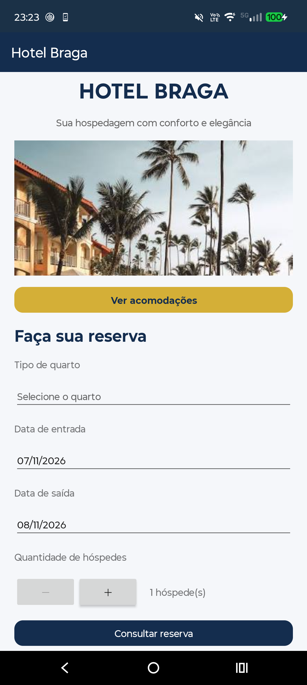
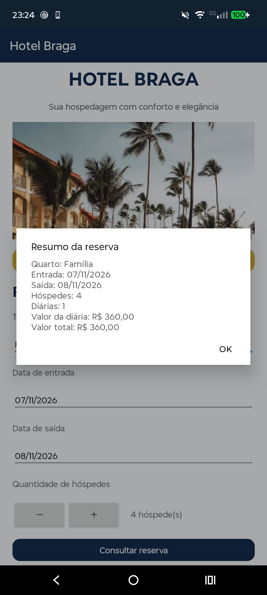
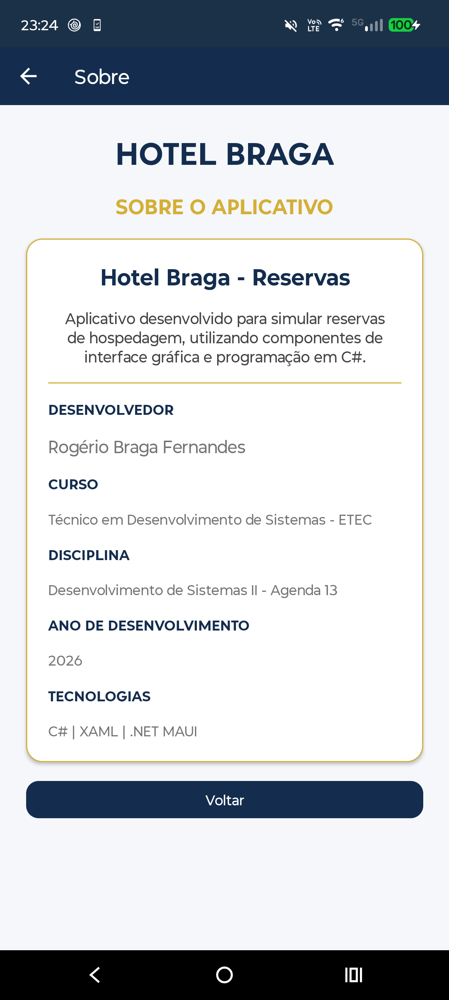

# 🏨 Hotel Braga 2.0

### Aplicativo de Reservas de Hospedagem | ETEC — 2026

Aplicativo Android desenvolvido em **.NET MAUI, C# e XAML**, como atividade acadêmica da **Agenda 13 de Desenvolvimento de Sistemas II**, do curso Técnico em Desenvolvimento de Sistemas da ETEC.

O projeto apresenta uma interface personalizada, funcionalidades de reserva de hospedagem e organização do código em camadas.

---

## 📱 Sobre o projeto

O **Hotel Braga 2.0** é um aplicativo de hospedagem que permite visualizar acomodações, consultar preços, selecionar datas de entrada e saída e calcular o valor total de uma reserva.

O projeto foi desenvolvido com foco na experiência do usuário, na organização do código e na aplicação prática dos conhecimentos adquiridos durante o curso.

---

## ✨ Funcionalidades

- Visualização de quatro tipos de acomodações.
- Imagens e descrições dos quartos.
- Consulta de preços e capacidade de hóspedes.
- Seleção das datas de entrada e saída.
- Escolha da quantidade de hóspedes.
- Cálculo automático do valor da hospedagem.
- Validação das informações da reserva.
- Tela **Sobre**, com informações do desenvolvedor.
- Ícone personalizado com a identidade visual HB.

---

## 🛏️ Acomodações disponíveis

| Acomodação | Valor da diária | Capacidade |
|---|---|---|
| Individual | R$ 180,00 | 1 pessoa |
| Casal | R$ 250,00 | 2 pessoas |
| Duplo | R$ 280,00 | 2 pessoas |
| Família | R$ 360,00 | 6 pessoas |

---

## 🛠️ Tecnologias utilizadas

- **C#** — linguagem de programação.
- **XAML** — construção das interfaces.
- **.NET MAUI** — desenvolvimento multiplataforma.
- **.NET 8** — plataforma de desenvolvimento.
- **Android** — sistema operacional utilizado nos testes.
- **Git e GitHub** — versionamento e armazenamento do projeto.
- **GitHub Actions** — compilação do aplicativo Android.

---

## 📁 Organização do projeto

O projeto utiliza uma estrutura de pastas para separar as responsabilidades do código, facilitando a manutenção, a leitura e a evolução do aplicativo.

### Models — Camada de modelos

- `Quarto.cs` — representa as informações de cada acomodação.
- `Reserva.cs` — armazena os dados da reserva e calcula as diárias e o valor total.

### Services — Camada de serviços

- `QuartoService.cs` — disponibiliza os dados dos quartos.
- `ReservaService.cs` — realiza as validações das reservas e disponibiliza o valor calculado.

### Views — Camada de apresentação

- `AcomodacoesPage.xaml` — interface visual das acomodações.
- `AcomodacoesPage.xaml.cs` — código associado à tela.

### Outras partes do projeto

- `MainPage.xaml` — tela principal.
- `SobrePage.xaml` — tela de informações do desenvolvedor.
- `Resources/` — imagens, ícones e recursos visuais.
- `Platforms/Android/` — configurações específicas do Android.
- `.github/workflows/` — automação da compilação.

Essa organização foi adotada para separar dados, serviços e interface, conforme as orientações da atividade.

---

## 📸 Capturas de tela

A seguir, estão as imagens reais do aplicativo Hotel Braga 2.0 em execução no Android.

### Tela 1

### Tela 2

### Tela 3

### Tela 4

### Tela 5

---

## 📋 Validações das reservas

O aplicativo realiza verificações para evitar informações inválidas:

- Seleção obrigatória de um quarto.
- Data de entrada não pode ser anterior à data atual.
- Data de saída deve ser posterior à entrada.
- Quantidade mínima de um hóspede.
- Quantidade de hóspedes limitada à capacidade do quarto.

O valor da reserva é calculado multiplicando a quantidade de diárias pelo preço da acomodação selecionada.

---

## 📲 Execução do aplicativo

O aplicativo foi compilado para Android utilizando o GitHub Actions e testado em um dispositivo Android.

O código-fonte está disponível neste repositório para consulta e estudo.

---

## 👨‍💻 Desenvolvedor

**Rogério Braga Fernandes**

Curso Técnico em Desenvolvimento de Sistemas  
ETEC — 2026

**Disciplina:** Desenvolvimento de Sistemas II  
**Atividade:** Agenda 13

---

## 📚 Finalidade acadêmica

Projeto desenvolvido para fins educacionais, com o objetivo de aplicar conhecimentos de desenvolvimento de interfaces, programação em C#, organização do código em camadas e desenvolvimento de aplicativos com .NET MAUI.

**Hotel Braga 2.0 — Projeto acadêmico ETEC 2026.**
